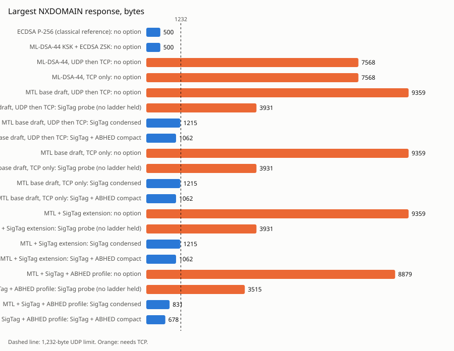
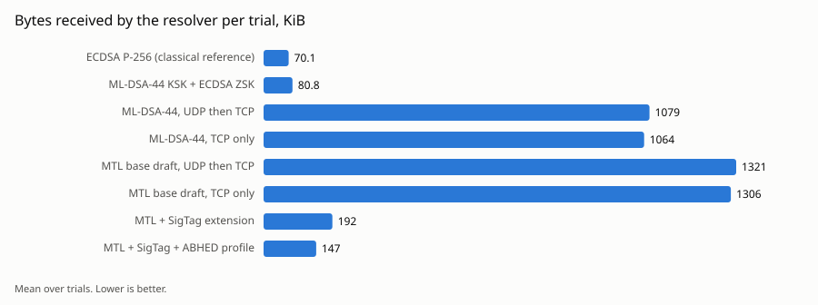
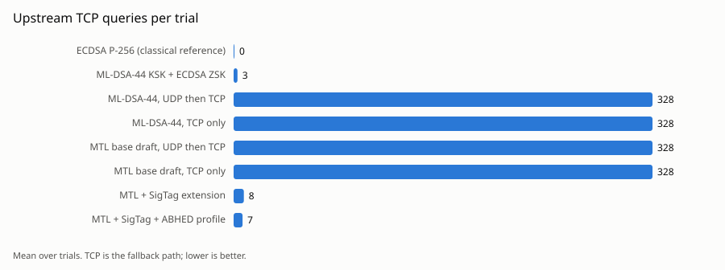
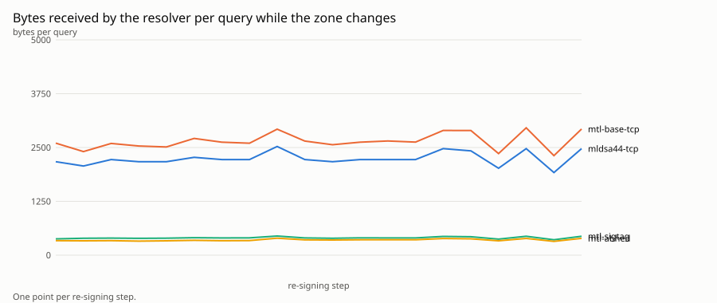

# ABHED-v2 results

Measured on the real stack: patched NSD 4.15.4 (authoritative) and patched Unbound 1.26.2 (validating resolver) serving and validating `.` → `lab.` → `iem.lab.`.
Upstream traffic is read from NSD's statistics (`nsd-control stats`), summed over the three servers.

Generated 2026-11-12 08:08 UTC by `abhed-bench report`.

## Response size against the 1,232-byte UDP limit

Exact bytes as the authoritative server writes them (TCP, so nothing is truncated). Each cell: min / mean / max, and the share that fits in 1,232 bytes.

| Zone | Encoding | Hosts | A (positive) | NODATA | NXDOMAIN | Referral + DS | DNSKEY |
|---|---|---|---|---|---|---|---|
| ECDSA P-256 (classical reference) | no option | 10000 | 166 / 166 / 166 (100%) | 344 / 344 / 344 (100%) | 500 / 500 / 500 (100%) | 228 / 228 / 228 (100%) | 299 / 299 / 299 (100%) |
| ML-DSA-44 KSK + ECDSA ZSK | no option | 10000 | 166 / 166 / 166 (100%) | 344 / 344 / 344 (100%) | 500 / 500 / 500 (100%) | 228 / 228 / 228 (100%) | 3903 / 3903 / 3903 (0%) |
| ML-DSA-44, UDP then TCP | no option | 10000 | 2522 / 2522 / 2522 (0%) | 5056 / 5056 / 5056 (0%) | 7568 / 7568 / 7568 (0%) | 2584 / 2584 / 2584 (0%) | 5151 / 5151 / 5151 (0%) |
| ML-DSA-44, TCP only | no option | 10000 | 2522 / 2522 / 2522 (0%) | 5056 / 5056 / 5056 (0%) | 7568 / 7568 / 7568 (0%) | 2584 / 2584 / 2584 (0%) | 5151 / 5151 / 5151 (0%) |
| MTL base draft, UDP then TCP | no option | 10000 | 3039 / 3110 / 3119 (0%) | 6170 / 6241 / 6250 (0%) | 9279 / 9350 / 9359 (0%) | 2845 / 2845 / 2845 (0%) | 5151 / 5151 / 5151 (0%) |
| MTL base draft, UDP then TCP | SigTag probe (no ladder held) | 10000 | 3043 / 3114 / 3123 (0%) | 3458 / 3529 / 3538 (0%) | 3851 / 3922 / 3931 (0%) | 2849 / 2849 / 2849 (0%) | 5155 / 5155 / 5155 (0%) |
| MTL base draft, UDP then TCP | SigTag condensed | 10000 | 327 / 398 / 407 (100%) | 742 / 813 / 822 (100%) | 1135 / 1206 / 1215 (100%) | 293 / 293 / 293 (100%) | 5155 / 5155 / 5155 (0%) |
| MTL base draft, UDP then TCP | SigTag + ABHED compact | 10000 | 276 / 347 / 356 (100%) | 640 / 711 / 720 (100%) | 982 / 1053 / 1062 (100%) | 242 / 242 / 242 (100%) | 5155 / 5155 / 5155 (0%) |
| MTL base draft, TCP only | no option | 10000 | 3039 / 3110 / 3119 (0%) | 6170 / 6241 / 6250 (0%) | 9279 / 9350 / 9359 (0%) | 2845 / 2845 / 2845 (0%) | 5151 / 5151 / 5151 (0%) |
| MTL base draft, TCP only | SigTag probe (no ladder held) | 10000 | 3043 / 3114 / 3123 (0%) | 3458 / 3529 / 3538 (0%) | 3851 / 3922 / 3931 (0%) | 2849 / 2849 / 2849 (0%) | 5155 / 5155 / 5155 (0%) |
| MTL base draft, TCP only | SigTag condensed | 10000 | 327 / 398 / 407 (100%) | 742 / 813 / 822 (100%) | 1135 / 1206 / 1215 (100%) | 293 / 293 / 293 (100%) | 5155 / 5155 / 5155 (0%) |
| MTL base draft, TCP only | SigTag + ABHED compact | 10000 | 276 / 347 / 356 (100%) | 640 / 711 / 720 (100%) | 982 / 1053 / 1062 (100%) | 242 / 242 / 242 (100%) | 5155 / 5155 / 5155 (0%) |
| MTL + SigTag extension | no option | 10000 | 3039 / 3110 / 3119 (0%) | 6170 / 6241 / 6250 (0%) | 9279 / 9350 / 9359 (0%) | 2845 / 2845 / 2845 (0%) | 5151 / 5151 / 5151 (0%) |
| MTL + SigTag extension | SigTag probe (no ladder held) | 10000 | 3043 / 3114 / 3123 (0%) | 3458 / 3529 / 3538 (0%) | 3851 / 3922 / 3931 (0%) | 2849 / 2849 / 2849 (0%) | 5155 / 5155 / 5155 (0%) |
| MTL + SigTag extension | SigTag condensed | 10000 | 327 / 398 / 407 (100%) | 742 / 813 / 822 (100%) | 1135 / 1206 / 1215 (100%) | 293 / 293 / 293 (100%) | 5155 / 5155 / 5155 (0%) |
| MTL + SigTag extension | SigTag + ABHED compact | 10000 | 276 / 347 / 356 (100%) | 640 / 711 / 720 (100%) | 982 / 1053 / 1062 (100%) | 242 / 242 / 242 (100%) | 5155 / 5155 / 5155 (0%) |
| MTL + SigTag + ABHED profile | no option | 10000 | 3007 / 3078 / 3087 (0%) | 5914 / 5985 / 5994 (0%) | 8799 / 8870 / 8879 (0%) | 2813 / 2813 / 2813 (0%) | 4196 / 4196 / 4196 (0%) |
| MTL + SigTag + ABHED profile | SigTag probe (no ladder held) | 10000 | 3011 / 3082 / 3091 (0%) | 3234 / 3305 / 3314 (0%) | 3435 / 3506 / 3515 (0%) | 2817 / 2817 / 2817 (0%) | 4200 / 4200 / 4200 (0%) |
| MTL + SigTag + ABHED profile | SigTag condensed | 10000 | 327 / 398 / 407 (100%) | 550 / 621 / 630 (100%) | 751 / 822 / 831 (100%) | 293 / 293 / 293 (100%) | 1516 / 1516 / 1516 (0%) |
| MTL + SigTag + ABHED profile | SigTag + ABHED compact | 10000 | 276 / 347 / 356 (100%) | 448 / 519 / 528 (100%) | 598 / 669 / 678 (100%) | 242 / 242 / 242 (100%) | 1465 / 1465 / 1465 (0%) |

## Resolver workload

5 trials × 500 queries, cold resolver per trial (Unbound restarted), different seed per trial. Mix: 80% A (Zipf-popular), 10% NXDOMAIN, 5% NODATA, 5% other. Zone: 10000 hosts.
Round trips = UDP queries + TCP queries + TCP connections.

| Configuration | Bytes received by resolver (KiB) | UDP queries | TCP queries | Truncated | Round trips | MTL full / condensed / compact | Resolver p50 ms | Failures | Not validated |
|---|---|---|---|---|---|---|---|---|---|
| ECDSA P-256 (classical reference) | 70.1 ± 3.9 | 328 ± 12.9 | 0 ± 0 | 0 ± 0 | 328 ± 12.9 | 0 / 0 / 0 | 0.2 ± 0.0 | 0 | 0 |
| ML-DSA-44 KSK + ECDSA ZSK | 80.8 ± 3.9 | 328 ± 12.9 | 3 ± 0 | 3 ± 0 | 334 ± 12.9 | 0 / 0 / 0 | 0.2 ± 0.0 | 0 | 0 |
| ML-DSA-44, UDP then TCP | 1079 ± 58.4 | 328 ± 12.9 | 328 ± 12.9 | 328 ± 12.9 | 984 ± 38.7 | 0 / 0 / 0 | 0.2 ± 0.0 | 0 | 0 |
| ML-DSA-44, TCP only | 1064 ± 57.8 | 0 ± 0 | 328 ± 12.9 | 0 ± 0 | 656 ± 25.8 | 0 / 0 / 0 | 0.2 ± 0.0 | 0 | 0 |
| MTL base draft, UDP then TCP | 1321 ± 71.8 | 328 ± 12.9 | 328 ± 12.9 | 328 ± 12.9 | 984 ± 38.7 | 750 / 0 / 0 | 0.2 ± 0.0 | 0 | 0 |
| MTL base draft, TCP only | 1306 ± 71.2 | 0 ± 0 | 328 ± 12.9 | 0 ± 0 | 656 ± 25.8 | 425 / 0 / 0 | 0.2 ± 0.0 | 0 | 0 |
| MTL + SigTag extension | 192 ± 9.1 | 328 ± 12.9 | 8 ± 0 | 8 ± 0 | 344 ± 12.9 | 10 / 420 / 0 | 0.2 ± 0.0 | 0 | 0 |
| MTL + SigTag + ABHED profile | 147 ± 6.0 | 328 ± 12.9 | 7 ± 0 | 7 ± 0 | 342 ± 12.9 | 11 / 0 / 421 | 0.2 ± 0.0 | 0 | 0 |

## Zone churn

Zone grows by 10 hosts per step and is re-signed (same key, same MTL series); NSD reloads; one long-lived resolver then asks 50 names it has not asked before (30% of them new). 20 steps.

| Configuration | TCP queries per 100 queries | Bytes per query | Re-sign + reload ms (mean) | Failures |
|---|---|---|---|---|
| ML-DSA-44, TCP only | 88.9 | 2244 | 514 | 0 |
| MTL base draft, TCP only | 88.9 | 2649 | 407 | 0 |
| MTL + SigTag extension | 4.0 | 403 | 401 | 0 |
| MTL + SigTag + ABHED profile | 4.0 | 353 | 398 | 0 |

